# Arquitetura — Kurio NFT Marketplace

Este documento explica **como o projeto funciona por dentro e por que foi feito assim**. Para instalar, rodar, testar e
auditar, vá ao [README](README.md). A versão publicada está em https://case-jungle-gaming.vercel.app.

## Por onde começar

| Se você quer saber…                                   | Leia                                                                     |
| ----------------------------------------------------- | ------------------------------------------------------------------------ |
| Como o app funciona em uma passada                    | [1. O caminho de uma compra](#1-o-caminho-de-uma-compra)                 |
| Como existe "backend" e tempo real sem servidor       | [3. O backend que não existe](#3-o-backend-que-não-existe)               |
| O que acontece quando o preço muda durante a compra   | [6. Tempo real no cliente](#6-tempo-real-no-cliente) e [7.3](#73-pedido) |
| O que foi corrigido a partir dos comentários do Figma | [8.4 Revisão de design](#84-revisão-de-design-os-comentários-do-figma)   |
| Por que a nota mobile do Lighthouse é a que é         | [9. Performance](#9-performance)                                         |
| Os contratos REST e os eventos Socket.IO              | [12. Contratos](#12-contratos-rest-e-eventos)                            |

## Sumário

1. [O caminho de uma compra](#1-o-caminho-de-uma-compra)
2. [Stack](#2-stack)
3. [O backend que não existe](#3-o-backend-que-não-existe)
4. [Base simulada e cenários](#4-base-simulada-e-cenários)
5. [Estado, cache e sincronização](#5-estado-cache-e-sincronização)
6. [Tempo real no cliente](#6-tempo-real-no-cliente)
7. [Sessão, carrinho e pedido](#7-sessão-carrinho-e-pedido)
8. [Interface](#8-interface)
9. [Performance](#9-performance)
10. [Testes](#10-testes)
11. [Limitações assumidas](#11-limitações-assumidas)
12. [Contratos REST e eventos](#12-contratos-rest-e-eventos)

## 1. O caminho de uma compra

A melhor forma de entender o projeto é seguir uma compra do começo ao fim. Cada passo aponta o arquivo onde a coisa
acontece.

1. **O app sobe.** `src/main.tsx` chama `boot()` (`src/app/boot.ts`), que liga o backend simulado **antes** de desenhar
   qualquer tela: carrega o MSW, abre o banco simulado e só então monta o React.
2. **Você abre o catálogo.** A rota `/` (`src/routes/_shell/index.tsx`) pede `GET /api/nfts` pelo hook de catálogo
   (`src/features/catalog`). O Axios (`src/lib/http/client.ts`) envia a requisição, o MSW a intercepta
   (`src/mocks/handlers/nfts.ts`) e o resultado é validado por um schema Zod de `src/contracts/` antes de chegar à tela.
3. **Você adiciona ao carrinho.** O hook de carrinho (`src/features/cart`) chama `POST /api/cart/items`. O servidor
   simulado guarda só `nftId + editionId + quantity`; o preço é sempre lido do NFT, então o carrinho nunca carrega um
   preço velho.
4. **Você vai para o pagamento.** `/pagamento` fica sob o layout `_authed` (`src/routes/_shell/_authed.tsx`): sem sessão,
   você é mandado para o login e volta depois. O checkout (`src/features/checkout`) pede uma **cotação**
   (`POST /api/quotes`), que recalcula preços, taxa de rede e cupom.
5. **O preço muda enquanto você está aqui.** Quem mudou o preço (o simulador, por exemplo) fala com o servidor simulado
   (`src/mocks/handlers/dev-nft.ts`); a base emite `nft.updated`, o servidor Socket.IO simulado
   (`src/mocks/socket/gateway.ts`) entrega o evento e o `socket.io-client` do app o recebe
   (`src/features/realtime`). O cache é corrigido, a cotação é refeita, aparece o alerta "o preço mudou" e **Confirmar
   compra** fica bloqueado até você clicar em "Aceitar alterações".
6. **Você confirma.** `POST /api/orders` (`src/features/checkout/hooks/use-place-order.ts`) leva uma chave de
   idempotência. Se a resposta se perder, repetir usa a **mesma** chave e devolve o **mesmo** pedido: nunca existem duas
   compras.
7. **O pedido é liquidado.** O servidor simulado leva cerca de 1,5 s e emite `order.updated`. O cliente confere o dono
   do evento, aplica a regra de versão e atualiza o recibo (`/pedido/:id`). Pedido confirmado ou recusado nunca volta atrás.

Tudo que é "servidor" mora em `src/mocks/`. Tudo que é "aplicação" mora fora dele, e o único ponto que carrega a camada de
mocks é o `boot.ts`; `features/` e `lib/` **nunca** importam de `mocks/`.

## 2. Stack

| Responsabilidade | Escolha                                   | Observação                            |
| ---------------- | ----------------------------------------- | ------------------------------------- |
| Build            | Vite 8                                    | Deploy na Vercel                      |
| Interface        | React 19.3                                | Versão sem a falha de segurança da 19.2|
| Linguagem        | TypeScript 5.9                            | `strict` + `noUncheckedIndexedAccess` |
| Roteamento       | TanStack Router                           | Baseado em arquivos, code splitting   |
| Estado remoto    | TanStack Query v5                         |                                       |
| HTTP             | Axios                                     |                                       |
| Tempo real       | socket.io-client 4.8                      |                                       |
| Estilo           | Tailwind CSS v4 + shadcn/ui               | Tokens em `@theme`                    |
| Mocks            | MSW 2.15 + `@mswjs/socket.io-binding` 0.2 | Ver seção 3                           |
| Testes           | Playwright                                |                                       |

O MSW fica na linha 2.x porque o `@mswjs/socket.io-binding@0.2.0` declara `msw: ^2.10.2` como dependência de par. Subir
para o MSW 3 quebraria o tempo real.

## 3. O backend que não existe

O desafio pede API, autenticação, pagamentos e tempo real sem backend. A solução: o **MSW intercepta as requisições no
navegador** e responde como um servidor responderia. O tempo real usa o mesmo caminho: existe um servidor Socket.IO
simulado dentro do MSW, e o app conversa com ele pelo `socket.io-client` de verdade, sem atalhos.

### 3.1 Três pegadinhas do transporte

Foram descobertas num teste de viabilidade. Nenhuma é óbvia no código, por isso ficam registradas.

- **O cliente só pode falar WebSocket.** O MSW intercepta WebSocket, mas não o _long-polling_ HTTP que o Socket.IO usa
  por padrão. Por isso `transports: ['websocket']` em `src/lib/realtime/socket.ts`.
- **A barra final do caminho quebra o casamento.** O Engine.IO acrescenta `/` ao caminho (`/socket.io/`), e o MSW compara
  contra `/socket.io`. A solução é `addTrailingSlash: false` no cliente.
- **A ordem de carregamento importa.** O `engine.io-client` guarda o `WebSocket` global **no momento em que o módulo é
  avaliado**, e o MSW troca esse global dentro de `worker.start()`. Se qualquer módulo avaliado antes do `start()`
  importar o `socket.io-client`, a conexão passa direto, sem erro visível: só um socket que nunca conecta. Duas
  consequências: `src/mocks/**` nunca importa o `socket.io-client`, e o app só desenha depois de o MSW subir.

### 3.2 Heartbeat

No Engine.IO v4 quem envia o `PING` é o servidor. O binding anuncia `pingInterval: 25000, pingTimeout: 5000`, mas nunca
envia o ping, então o cliente se derrubava sozinho a cada 30 s e reconectava em ciclo. O gateway agora envia o `PING` por
conta própria a cada 20 s (`src/mocks/socket/gateway.ts`). Com `?heartbeat=0` ele é desligado, o que reproduz o _ping
timeout_ nos testes.

### 3.3 Worker encerrado pelo navegador

O MSW responde pela rede através de um _service worker_. Quando o navegador o encerra por inatividade, o worker acorda
sem saber quais abas atender e deixa **todas** as chamadas passarem direto. No Vite e na Vercel (que reescreve tudo para
`index.html`), um `GET /api/nfts` passa a devolver o HTML do app com status 200, e o catálogo mostrava "Não foi possível
carregar". A correção tem duas pontas:

- `src/lib/http/client.ts` trata resposta `text/html` numa rota `/api` como falha de rede e dispara um evento; as leituras
  do Query já tentam de novo.
- `src/mocks/worker-guard.ts` faz `GET /api/__mock__/ping` ao focar a janela, ao voltar a aba, ao reconectar e a cada 15
  s; se a resposta não for JSON, reenvia `MOCK_ACTIVATE` ao worker.

O arquivo `public/mockServiceWorker.js` também foi ajustado para interceptar **só `/api/`** (fontes, imagens e scripts
passam direto). Por isso o `package.json` não declara `msw.workerDirectory`: senão o `postinstall` do MSW sobrescreveria
o ajuste a cada instalação.

### 3.4 Limites do transporte

Sem namespaces, rooms ou broadcast (o binding não os implementa) e com `sid` fixo (`"test"`). O isolamento entre usuários
é feito na aplicação: eventos de pedido só vão aos sockets que se identificaram como donos.

## 4. Base simulada e cenários

### 4.1 A base

`src/mocks/db` guarda registros internos que **não** são as formas da API: o "servidor" é dono do hash de senha e das
referências cruas, e os handlers projetam isso nos contratos. Toda escrita passa por `mutate()`, que persiste e só então
emite os eventos, então nenhum evento sai antes de o estado estar consistente. O gateway monta cada evento lendo o mesmo
store que os handlers REST leem, e por isso REST e Socket.IO nunca divergem.

A base persiste no `localStorage` (`kurio:mock-db`, com `schemaVersion`; versão diferente é descartada e semeada de
novo). Senhas usam SHA-256 com salt por usuário, o que não seria suficiente num backend real (ali seria Argon2 ou bcrypt),
mas mantém o seed reprodutível. A sessão dura 30 minutos, sem renovação.

### 4.2 Cenários de rede

Escolhidos por query string, por `POST /api/__mock__/scenario` ou pelo painel do simulador. **Nada usa `Math.random`**: a
latência variável vem de um gerador semeado e as falhas intermitentes são contadas por requisição, para os testes serem
determinísticos.

| Latência       | Comportamento                                      |
| -------------- | -------------------------------------------------- |
| `none`         | 0 ms                                               |
| `fast`         | 120 ms (padrão)                                    |
| `slow`         | 1,5 s                                              |
| `variable`     | 100–2000 ms, gerador semeado                       |
| `out-of-order` | Cada requisição resolve mais rápido que a anterior |

| Falha          | Comportamento                                    |
| -------------- | ------------------------------------------------ |
| `offline`      | Falha de transporte, não status HTTP             |
| `server-error` | 500 com envelope `SERVER_ERROR`                  |
| `timeout`      | Nunca resolve; quem encerra é o timeout do Axios |
| `intermittent` | Falha 1 a cada `failEvery` requisições           |
| `unauthorized` | 401, para simular expiração no meio do fluxo     |

`scope` restringe a falha a prefixos de caminho (por exemplo, derrubar só `/api/cart`).

### 4.3 Rotas de controle

Ficam fora da simulação de rede de propósito: é preciso conseguir desligar uma falha mesmo com o cenário `offline` ativo.

| Rota                                           | Função                                                                                |
| ---------------------------------------------- | ------------------------------------------------------------------------------------- |
| `POST /api/__mock__/reset`                     | Restaura a base semeada; o contador de versões nunca volta atrás                      |
| `GET\|POST /api/__mock__/scenario`             | Lê ou ajusta as condições de rede                                                     |
| `POST /api/__mock__/expire-sessions`           | Expira todas as sessões na hora                                                       |
| `GET /api/__mock__/state` · `/ping`            | Snapshot para testes · resposta de saúde do worker                                    |
| `POST /api/__mock__/nfts/:slug`                | Muda preço ou disponibilidade e emite `nft.updated`                                   |
| `GET /api/__mock__/socket`                     | Quantos clientes Socket.IO estão conectados e quanto falta de uma queda simulada      |
| `POST /api/__mock__/socket/drop` · `reconnect` | Derruba as conexões (com `holdMs` recusa novas) · encerra a queda                     |
| `POST /api/__mock__/socket/emit` · `replay`    | Entrega um evento arbitrário · reenvia o último (`duplicate`) ou o anterior (`stale`) |

### 4.4 Simulador de mercado

`src/features/market-simulator` é um painel (oculto por padrão; `?simulador=1` ou `Ctrl+Alt+M`) que **só chama essas
rotas**. A mudança entra na base, o evento atravessa o Socket.IO simulado e só então o cache do app é atualizado: o
painel nunca escreve no cache. O módulo é carregado sob demanda e só existe com os mocks ligados.

### 4.5 Fixtures

O catálogo é gerado em tempo de execução (`src/mocks/fixtures/generate-nfts.ts`) a partir de uma semente fixa, na primeira
visita ou após o reset: são **239 NFTs** em 27 páginas de 9. A distribuição por coleção reproduz o painel lateral do
Figma, e os nove primeiros itens são os do layout, com nome, preço e raridade idênticos. Há 4 NFTs esgotados, 22 com
preço anterior riscado e estoques de 0 a 40, para que cada cenário exista de verdade. Duas contas (`ana@kurio.test` e
`bruno@kurio.test`) têm carrinhos, favoritos, carteiras e pedidos independentes, o que sustenta os testes de isolamento.

As contagens por rede do Figma (119, 78 e 86) somam 283 e são incompatíveis com as por coleção, que somam 239. Foi mantida
a de coleção e as redes foram distribuídas na mesma proporção (101, 66 e 72); os números na tela são derivados dos dados.

## 5. Estado, cache e sincronização

### 5.1 Camadas

`contracts/` (Zod) → `features/*/api` (Axios + validação) → `features/*/hooks` (TanStack Query) → componentes. Nenhum
componente chama o Axios e nenhuma resposta fictícia existe fora de `src/mocks/`. O cliente HTTP injeta `Authorization` e
`x-visitor-id`, aplica timeout de 8 s e converte todo erro em `ApiRequestError`. Um `401` fora das rotas de credencial
dispara a expiração de sessão.

### 5.2 Chaves de query e isolamento

```
['catalog', scope, 'list' | 'detail' | 'related' | 'featured', ...]
['private', scope, 'cart' | 'quote' | 'wallets' | 'profile' | 'favorites' | 'orders', ...]
```

`scope` é o id do usuário ou `guest`, e a chave inclui todos os parâmetros da consulta. Login, logout e expiração chamam
`resetQueryCache`, que cancela o que está em voo e esvazia o cache inteiro: nada da sessão anterior sobrevive.

### 5.3 Política de cache

| Item                         | Política                                                                                            |
| ---------------------------- | --------------------------------------------------------------------------------------------------- |
| Padrão                       | `staleTime` 30 s, `gcTime` 5 min, sem refetch ao focar a janela                                     |
| Leituras                     | Até 2 tentativas, nenhuma em 4xx. **Mutations não repetem**: repetir é decisão do usuário           |
| Catálogo e favoritos (lista) | `keepPreviousData`: a página anterior segue visível, com `aria-busy`, enquanto a nova carrega       |
| Coleções, redes, destaques   | `staleTime` 5 min                                                                                   |
| Carteiras e ids de favoritos | `staleTime` 60 s                                                                                    |
| Carrinho                     | `staleTime` 10 s; mutations gravam a resposta no cache                                              |
| Sessão                       | `staleTime` 60 s; só `401` expira a sessão, qualquer outra falha mostra erro com "Tentar novamente" |
| Cotação                      | `staleTime` infinito, `gcTime` 0, refaz ao focar a janela e a cada `nft.updated`                    |
| Pedido pendente              | Polling de 1,5 s enquanto `pending`, além do evento `order.updated`                                 |

**Atualização otimista.** O favorito muda na tela antes da resposta; se der erro, o estado anterior volta e o usuário é
avisado. Um teste derruba a rota e confere o retorno.

## 6. Tempo real no cliente

`features/realtime` carrega de forma preguiçosa (é requisito do transporte e ainda tira o `socket.io-client` do caminho
crítico). Um socket por usuário: trocar de usuário fecha o anterior e abre outro, que se identifica com `session.identify`.

As regras que tornam eventos duplicados, atrasados ou de outro dono inofensivos:

- **Ledger de eventos** (`lib/event-ledger.ts`): descarta `eventId` repetido e qualquer versão menor ou igual à maior já
  vista para o recurso.
- **Guarda de versão no cache** (`lib/patch-nft.ts`): o patch só altera um NFT cuja `version` seja menor que a do evento.
- **Guarda de dono**: `order.updated` só vale se o `ownerId` for o usuário atual, e a checagem vem **antes** do ledger, para
  um evento alheio de versão alta não bloquear os eventos reais do pedido.
- **Estados terminais**: `confirmed` e `declined` nunca são alterados por evento posterior.
- **Reconciliação**: a cada reconexão (não na primeira) as queries ativas são invalidadas e relidas por REST. Enquanto isso,
  eventos continuam sendo aplicados pela regra de versão, então uma resposta REST antiga não sobrescreve um evento novo. O
  contador do servidor simulado nunca volta atrás, nem no reset.

**O que o usuário vê.** No carrinho: um aviso (região `aria-live`), o resumo atualizado e uma **nota que fica na linha do
item** ("Subiu, era 1.19 ETH", "Restam 1"), com ícone e texto. No checkout: a cotação é refeita, o alerta aparece e
**Confirmar compra** fica desabilitado até aceitar; se o diálogo de confirmação estava aberto, ele fecha. Comprar as
últimas unidades não gera aviso contra o próprio usuário.

## 7. Sessão, carrinho e pedido

### 7.1 Sessão

O token vai em `Authorization: Bearer` e fica no `localStorage` (`kurio:session-token`). Um backend de produção usaria
cookie `httpOnly`; aqui o header se comporta igual no navegador e no Node, o que importa porque os mesmos handlers
sustentam os testes. As rotas privadas ficam sob `_authed`, que redireciona para `/entrar?redirect=...`; o destino passa por
`sanitizeRedirect` (só caminhos internos). Um `401` limpa o token e o cache e leva a `/entrar?redirect=...&expired=1`.

### 7.2 Carrinho

O estado fica no servidor, por usuário ou por `x-visitor-id`. No login, o carrinho do visitante é fundido ao da conta;
quantidades que não cabem mais no estoque são reduzidas ao possível em vez de rejeitadas (perder a linha inteira por uma
edição esgotada seria pior). Há **uma taxa de rede por cadeia** no carrinho, porque comprar em duas redes são duas
transações. Cupom fixo nunca excede o subtotal. A interface não calcula dinheiro: o servidor é a referência, e toda conta
passa por `lib/money/eth.ts` (`big.js`, valores como string decimal).

### 7.3 Pedido

1. `POST /quotes` gera a cotação e as `issues`. 2. A carteira é conectada (simulada; `wallet=reject` a recusa). 3.
   `POST /orders` leva a chave `x-idempotency-key`, estável por cotação. 4. O recibo é um _snapshot_ imutável.

**Cotação aceita de forma explícita.** O servidor compara cada cotação nova com a **última aceita** pelo usuário, não com
a última emitida. Assim o alerta de preço alterado persiste através de refetch por foco, troca de carteira ou reload, até
o clique em "Aceitar alterações e atualizar". Uma cotação com qualquer `issue`, ou vencida (5 minutos), não pode ser
enviada. Um `409 QUOTE_STALE` fecha o diálogo e mostra o alerta.

**Recuperação.** O id do pedido pendente fica no `localStorage`, e `/pedido/:id` o relê. Se a criação termina em erro de
transporte ou 5xx (resultado ambíguo), o corpo da tentativa é guardado e o checkout mostra **Verificar pedido**. Toda nova
tentativa reenvia o corpo guardado com a **mesma chave**, então um timeout nunca gera uma segunda compra.

**Privacidade.** O logout apaga token, notas do carrinho, tentativa de pedido (que guarda nome e e-mail), pedido pendente e
chaves de idempotência, além de zerar o cache. A expiração **preserva** a tentativa e o pedido do próprio usuário
(guardados por id) justamente para retomar a compra após novo login; a troca de usuário nunca os lê.

## 8. Interface

### 8.1 Layout responsivo

| Faixa         | Layout                                                               |
| ------------- | -------------------------------------------------------------------- |
| < 768 px      | Mobile: os frames móveis do Figma                                    |
| 768 – 1279 px | Tablet: o layout mobile numa coluna central de 640 px (não há frame) |
| ≥ 1280 px     | Desktop: frames de 1440 px, contêiner de 1200 px                     |

A troca é feita por `useIsDesktop()` (`min-width: 1280px`), então só uma árvore é montada. Confirmação, perfil, carteiras,
favoritos e 404 no mobile são derivados do padrão visual, pois o Figma não os traz.

### 8.2 Acessibilidade

- Pular para o conteúdo, foco visível global e diálogos Radix com foco aprisionado, retorno do foco e `Esc`.
- Campos com `label`, `aria-invalid`, `aria-describedby` e `aria-required` (inclusive os selects, já que o asterisco visual
  é `aria-hidden`).
- Cada rota define o `<title>` e anuncia a mudança por uma região educada para leitores de tela.
- O botão "−" bloqueado usa `aria-disabled` (continua focável e explica o limite); as notas do carrinho têm ícone e texto,
  nunca só cor. Ações fora do escopo são botões `aria-disabled` que respondem "não está disponível nesta versão".
- O carrossel de destaques não avança com "reduzir movimento", pausa com foco por teclado e com a aba oculta.
- O teste de responsividade mede os retângulos dos elementos em 320, 390, 768 e 1440 px, porque o `overflow-x: clip` do
  corpo esconde vazamentos reais de `scrollWidth`.

### 8.3 Desvios do Figma e decisões de UX

| Item                       | Decisão                                                                                                                                                             |
| -------------------------- | ------------------------------------------------------------------------------------------------------------------------------------------------------------------- |
| Cores                      | Acrescentadas as que o Figma não tem: erro `#E2574C`, sucesso `#5C9E6B`, hover de botão `#C07A3C` e superfície elevada `#2F1D17`                                    |
| Fonte                      | Iguais as do Figma.                                                                                                                                                 |
| Container                  | 1200 px centralizado: a medição dos screenshots mostra o conteúdo começando em x=120 num viewport de 1440, e não 80 px de padding                                   |
| Separador decimal          | Ponto em todos os valores (`1.19 ETH`); o Figma alterna entre ponto e vírgula                                                                                       |
| Grade do catálogo (mobile) | Duas colunas **alinhadas** (o Figma escalona a direita), por decisão de produto                                                                                     |
| Quantidade (−/+)           | Com 1 unidade o "−" fica bloqueado de forma bem visível (fundo apagado, anel, cursor proibido, dica "Quantidade mínima: 1")                                         |
| Pagamento                  | No desktop lista as carteiras reais; no mobile o pedido usa os dados do perfil. O diálogo de revisão lista itens, taxa e total antes do envio                       |
| Filtros ativos             | Aparecem como chips removíveis com "Limpar filtros" (não existem no Figma; tornam o estado da URL visível)                                                          |
| Abas do catálogo           | "Todos", "Novos lançamentos" e "Em alta" mostram conjuntos diferentes (`new`: lançados nos 14 dias anteriores à data fixa do catálogo; `trending`: ≥ 150 favoritos) |
| Modais (desktop)           | Sempre no tamanho do Figma, centralizados quando cabem; em janelas baixas a própria sobreposição rola. Clicar fora e `Esc` fecham                                   |
| Avatar e pedidos           | O avatar é um seletor de emoji (sem upload) e não há tela de histórico de pedidos; o recibo abre pelo link do pedido                                                |
| Simulador de mercado       | Painel de demonstração, oculto por padrão; não altera nenhuma tela quando fechado                                                                                   |

**Artes dos NFTs.** O Figma não acompanha as artes, mas três foram fornecidas; o quarto personagem (o gorila de chapéu) foi
recortado do screenshot em resolução original. Os originais ficam em `assets/nft-source/` e `npm run art` gera as
variantes (`{arte}-{160…960}.webp`, de 3 a 56 KB). Cada espaço da interface declara um `sizes` exato, então o navegador
baixa a menor variante que cobre o tamanho real em pixels. `npm run art:check` é o portão de qualidade: cada variante
precisa ter SSIM ≥ 0,97 contra o original. São quatro personagens para 239 NFTs, então as artes se repetem, como no Figma.

### 8.4 Revisão de design: os comentários do Figma

Quem revisou o layout deixou 13 comentários no Figma, e depois um 14º foi acrescentado. Cada um foi tratado e tem um teste
em `e2e/design-review.spec.ts` que **falha no código anterior e passa no atual**. Onde o comentário aponta um defeito do
próprio layout, a implementação se afasta do Figma de propósito. Os prints abaixo comparam o app antes e depois.

#### 1. Coleções fora de ordem alfabética

A lista agora sai em ordem alfabética (pt-BR). A ordenação é feita pela própria API (`GET /collections`), então o painel
lateral, o filtro do mobile e qualquer outro consumidor recebem a mesma ordem. _(`mocks/handlers/nfts.ts`)_

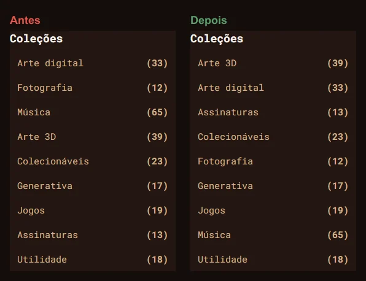

#### 2. Seletor do destaque colado na imagem

Os pontos saíram do canto da imagem e ficam **abaixo** dela, centralizados na largura da imagem e fora da área da
transição entre slides. _(`hero/hero-section.tsx`)_

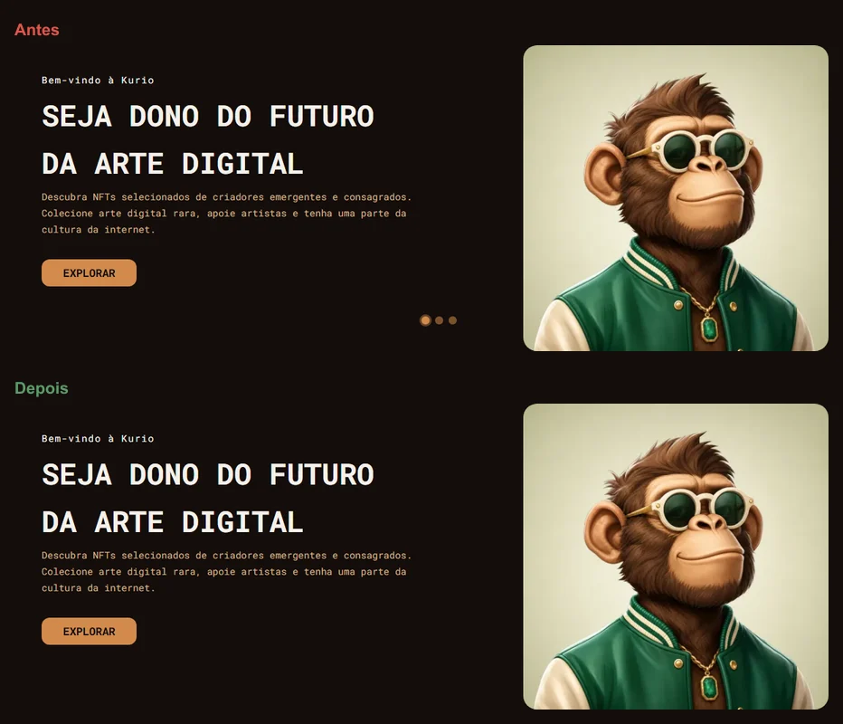

#### 3. Falta de uniformidade nos cards

O respiro entre a imagem e a moldura era de 4 px nas laterais e 25 px em cima e embaixo. Agora é **igual nos quatro lados**
(16 px no desktop, 14 px nos carrosséis, 8 px no mobile), e os esqueletos usam as mesmas medidas. _(`nft-card.tsx`)_

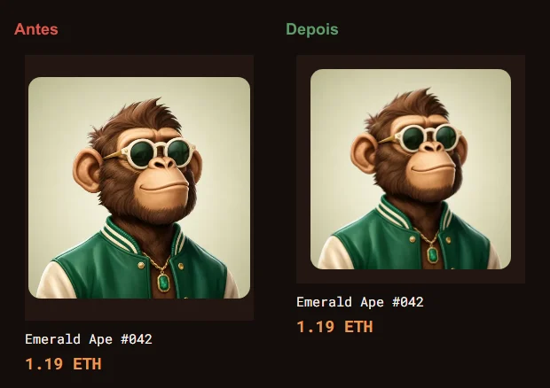

#### 4. Faltando margem nos cartões promocionais

O botão **Explorar** deixou de ser posicionado em absoluto (onde encostava na descrição e cortava o texto): agora é o
último item do fluxo, com 16 px de folga em cima, 24 px da borda direita e a mesma distância embaixo. O limite de linhas da
descrição foi removido. _(`promo-cards.tsx`)_

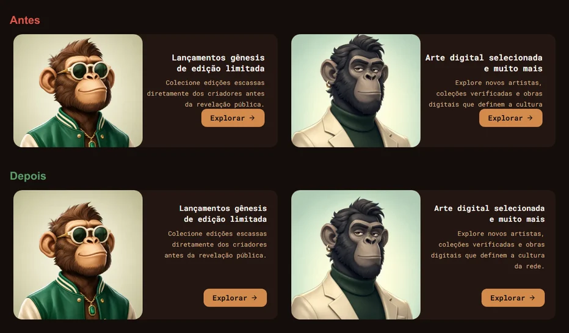

#### 5. Texto muito próximo no carrinho

O cabeçalho da tabela ficava a 4 px do caminho de navegação; agora há 24 px. _(`cart-page.tsx`)_

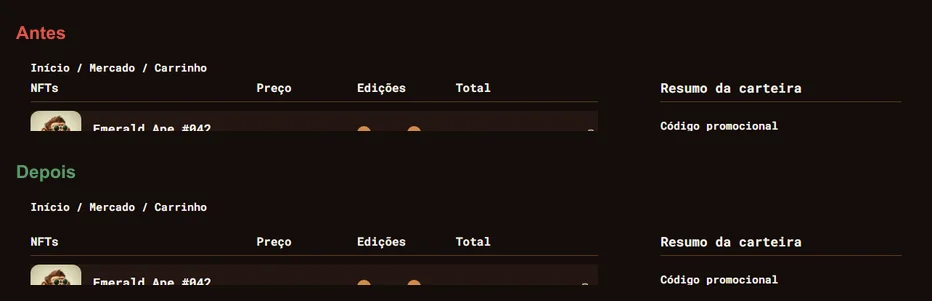

#### 6. Lixeira do carrinho sem centralizar

A lixeira ficava colada na borda direita da linha; agora é centralizada na sua coluna, com 8 px de folga. _(`cart-row.tsx`)_

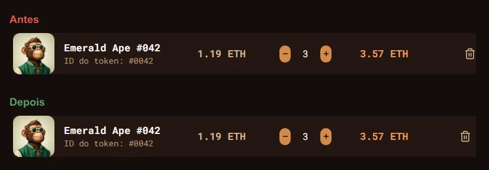

#### 7. Ícone do select de carteira

Medi todos os selects: o ícone **já estava centralizado** na vertical (0 px de desvio) e com folga igual à do texto.
Nada foi alterado; o comportamento ganhou um teste de regressão. _(`ui/select.tsx`)_

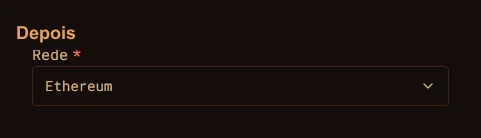

#### 8. Textos do recibo mais à direita

**Taxa de rede**, **Desconto** e **Total** passam a alinhar à direita, colados na coluna de valores, em vez de flutuar a
169 px da borda esquerda. _(`order-fees.tsx`)_

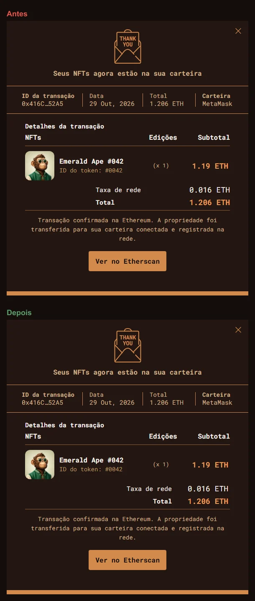

#### 9. Tipografia do "Ordenar por"

Faltava espaço depois dos dois-pontos. O rótulo usa a cor secundária e o valor escolhido vai em negrito, com 8 px entre
eles. _(`catalog-toolbar.tsx`)_

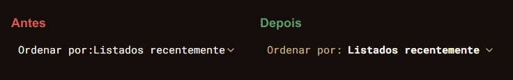

#### 10. Ícone desproporcional no botão Entrar

O botão usava o ícone de **sair** a 16 px num botão de 35 px. Trocado pelo de **entrar**, com 14 px (40% da altura do
botão) e traço mais firme. _(`header/account-control.tsx`)_

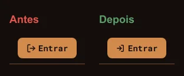

#### 11. Imagem sobreposta no banner mobile

A miniatura decorativa que cobria a imagem em destaque foi **removida**: duas imagens sobrepostas não comunicavam nada e
escondiam o NFT em destaque. _(`mobile-hero-banner.tsx`)_


#### 12. Falta de margem nas abas do mobile

As abas "Todos os NFTs / Novos lançamentos / Em alta" ganharam 24 px de distância do banner (eram 12 px).
_(`mobile-feed-tabs.tsx`)_


#### 13. Sem espaço para o botão de excluir no carrinho mobile

A lixeira foi para o canto superior direito e o seletor de quantidade para o inferior direito, com mais de 8 px entre os
dois e sem tocar no texto. _(`mobile-cart-item.tsx`)_

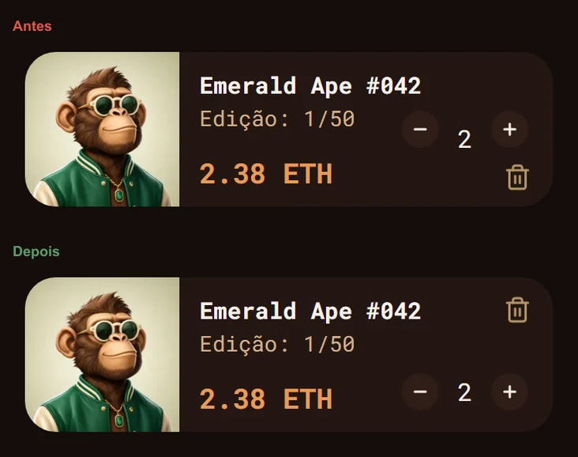

#### 14. Título da newsletter desalinhado no rodapé

O título "Antecipe-se ao próximo lançamento" usava um tamanho e uma altura de linha diferentes dos outros títulos (18 px com
linha de 16 px), então quebrava em duas linhas coladas e ficava mais alto que os demais. Agora usa o mesmo estilo (17 px,
linha de 24 px), cabe em uma linha e fica **na mesma linha dos outros três títulos**; o campo de e-mail começa onde as
descrições começam. As colunas foram levemente redistribuídas para o texto não encostar na borda direita.
_(`footer/newsletter-form.tsx`, `footer/feature-band.tsx`)_

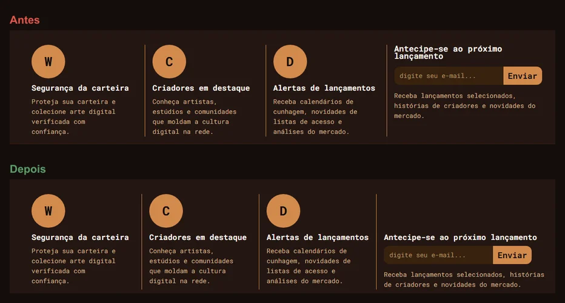

## 9. Performance

### 9.1 O que foi feito (vale para qualquer usuário)

Nada depende de `navigator.webdriver`, do user agent ou de parâmetro de URL, e a auditoria carrega as mesmas imagens,
fontes e funcionalidades do uso normal: o desafio proíbe simplificar só para a pontuação. A latência padrão dos mocks
continua em 120 ms, as fontes não foram subsetadas e as imagens não perderam qualidade.

- **Boot em etapas** (`app/boot.ts`): cada `import()` pesado avalia numa tarefa própria, com `yieldToMain` entre eles (zod,
  runtime do MSW, mocks, montagem), para nenhuma tarefa passar de ~50 ms.
- **Chunks**: `react`, `tanstack`, `vendor` (axios, zod, tailwind-merge, big.js), `msw`, `mocks` e `preload` (os helpers do
  próprio boot). **Regra importante:** o ponto de entrada não pode importar estaticamente `msw`, `vendor` ou `mocks`, senão
  tudo é avaliado numa só tarefa antes do primeiro `yield`. Qualquer mudança de chunking exige rodar os testes de tempo real.
- **Preload por rota** (`build/plugins/route-preload.ts`) e `prefetchQuery` nas rotas `/` e `/nft/:slug`, em paralelo com o
  download da página.
- **Fora do caminho crítico:** árvores desktop, cabeçalho e rodapé desktop, painel de filtros, `sonner`, `RealtimeBridge`
  (com o `socket.io-client`) e o simulador, carregados sob demanda ou em tempo ocioso.
- **Renderização escalonada** no mobile: os quatro primeiros cards primeiro, o resto em seguida.
- **Imagens** em variantes de 160 a 960 px com `sizes` exato; `vercel.json` dá cache longo a `/fonts/*` e `/assets/*`.

### 9.2 Como medir

`npm run lighthouse` compila, sobe um servidor local HTTP/2 com Brotli (que se comporta como a CDN da Vercel) e roda 3
medições por página (início e detalhe) e perfil (mobile e desktop), com armazenamento limpo a cada uma. Os relatórios ficam
em `lighthouse/reports/`, e a tabela do README é reescrita ao fim. `LH_URL=https://...` audita uma URL pública, como a da
Vercel. Para investigar, `lighthouse/lantern.mjs` repete a simulação do Lighthouse sobre o mesmo trace e
`lighthouse/trace.mjs` atribui as tarefas longas a scripts e funções.

### 9.3 Resultados

Última auditoria completa (medianas de 3 medições):

| Página  | Perfil  | Performance       | Acessibilidade | Boas práticas | SEO | LCP    | CLS | TBT    |
| ------- | ------- | ----------------- | -------------- | ------------- | --- | ------ | --- | ------ |
| Início  | Desktop | 100               | 97             | 100           | 100 | 0,59 s | 0   | 0 ms   |
| Detalhe | Desktop | 100               | 100            | 100           | 100 | 0,56 s | 0   | 0 ms   |
| Início  | Mobile  | 92 (92 / 94 / 92) | 100            | 100           | 100 | 2,66 s | 0   | 221 ms |
| Detalhe | Mobile  | 94 (96 / 94 / 94) | 100            | 100           | 100 | 2,56 s | 0   | 193 ms |

Todas as metas são atendidas (Performance ≥ 90, Acessibilidade ≥ 95, Boas práticas ≥ 95, SEO ≥ 90), com CLS 0.

**A nota mobile depende da CPU de quem mede.** O Lighthouse reduz a CPU 4× sobre a CPU real da máquina. No notebook de
desenvolvimento, que reduz a frequência sob carga (~42% do máximo, benchmark de 1000 a 1600), a mesma versão deu 79 e 81;
com a CPU em frequência cheia, deu de 92 a 96. O `benchmarkIndex` de cada medição fica em `lighthouse/reports/summary.json`.

**O que mais pesava e foi resolvido.** O ponto de entrada importava estaticamente o chunk `mocks`, porque o agrupador pôs ali
duas funções minúsculas do próprio boot (`yieldToMain` e o helper de preload do Vite). O MSW, o zod/axios e os mocks eram
avaliados juntos numa única tarefa de ~36 ms, o que derrotava o boot em etapas. Esses helpers foram para o chunk próprio
`preload`: a maior tarefa caiu de ~36 para ~15 ms, o TBT mediano do início mobile foi de 540 para 204 ms e o LCP caiu ~200 ms.

**O que ainda separa o mobile de 100:**

1. **Bytes de JavaScript antes do primeiro card**: ~270 KB em Brotli. React, MSW, zod e axios somam ~55%. O MSW existe só
   porque o desafio manda simular o backend no cliente; um backend real não teria esse custo.
2. **CPU 4× sobre tarefas inevitáveis**: restam quatro tarefas de 15 a 30 ms reais (avaliação de zod e mocks, criação do
   roteador e da raiz do React, primeiro render, primeiro layout), que viram ~200 ms de TBT.
3. **HTML e TLS fixos** (~780 ms na simulação) e uma janela de download de ~205 KB/s: cada 1 KB de JS antes do primeiro card
   custa ~5 ms de LCP.
4. Em HTTP/1.1 (`LH_SERVER=preview`) o mesmo build cai para ~80, porque dezenas de arquivos pequenos viram várias ondas de
   requisição; o servidor da auditoria usa HTTP/2, como a Vercel.

Ficaram de fora, por regra do desafio ou por custo: subsetar fontes, condicionar por user agent, perder qualidade de imagem,
reduzir a latência dos mocks, preload da imagem do LCP (ganho de ~30 ms), trocar o axios por `fetch`, `zod/mini` e mover banco
e handlers para um Web Worker.

## 10. Testes

`npm run test:e2e` (Playwright, Chromium) compila e sobe o **build de produção** com os mocks ativos, sempre novo
(`reuseExistingServer` é falso, para nunca testar um build antigo). O projeto `desktop` (1440×900) roda tudo; o `mobile`
(390×844) roda os testes marcados `@mobile`. Cada teste começa com armazenamento vazio e base semeada.

O relógio das cenas sensíveis ao tempo é controlado por `page.clock`; latência e falhas vêm dos cenários; os eventos de
tempo real são disparados pelas rotas de controle e chegam ao app pelo `socket.io-client`, nunca por setters ou pelo
cache. Esperas fixas foram trocadas por condições observáveis.

A tabela dos 12 cenários do desafio e os arquivos que os cobrem estão no [README](README.md#71-cobertura-dos-12-cenários-do-enunciado).
Além do caminho feliz, a suíte cobre resultado vazio, respostas fora de ordem, expiração de sessão no meio da navegação e
da confirmação, clique repetido e timeout com a mesma chave, recusa de carteira, preço e disponibilidade alterados com o
diálogo aberto, evento de outro dono, queda do socket com pedido pendente, foco de todos os diálogos e ausência de
deslocamento de layout nos esqueletos.

**Regressão visual.** `visual.spec.ts` compara início, detalhe, carrinho e pagamento em 1440 e 390 px (tolerância de 2%,
animações desligadas, relógio e dados fixos). A renderização de texto muda a altura das páginas entre sistemas, então há
baselines para **Windows** e para **Linux** (esta gerada na imagem oficial do Playwright); em outro sistema os testes visuais
são pulados com instruções para gerar as próprias.

## 11. Limitações assumidas

- Sem backend real: sessão em `Authorization`/`localStorage`, senhas em SHA-256 com salt, tempo real simulado no navegador.
- **Cada aba tem a sua própria base simulada** (em memória, persistida ao mudar; a última escrita vence entre abas). Por isso
  o simulador age sobre a aba em que foi aberto.
- O MSW não intercepta _long-polling_, então o cliente fala só WebSocket; o binding não tem namespaces nem rooms e usa um `sid`
  fixo.
- Login social, recuperação de senha, Atividade, Ofertas, Arquivos baixados, Suporte, Criadores e Aprenda não existem; os
  controles avisam que estão fora do escopo. O avatar é um seletor de emoji e não há histórico de pedidos.
- A apresentação arredonda valores a quatro casas decimais; o servidor é a referência.
- Em desenvolvimento (`npm run dev`) o `StrictMode` abre duas conexões Socket.IO por montagem (uma é encerrada antes do
  handshake). Não ocorre no build.
- A nota mobile do Lighthouse depende da CPU do host (seção 9.3).

## 12. Contratos REST e eventos

Todos os schemas vivem em `src/contracts/` (Zod) e os tipos são inferidos deles. Os **mesmos** schemas validam as respostas
no cliente e as requisições nos handlers do MSW, então um desvio de contrato falha na rede, não três camadas acima. Base
path: `/api`.

### 12.1 Convenções

- **Dinheiro:** strings decimais (`"1.19"`), nunca `number`; o tipo `EthAmount` tem _brand_ e a conta passa por
  `lib/money/eth.ts`. Quantidades são inteiras.
- **Versão:** todo recurso mutável tem `version` monotônico, igual em REST e em eventos. O cliente descarta o que não for
  estritamente maior.
- **Visitante:** toda requisição envia `x-visitor-id`; o carrinho de quem não entrou se liga a ele e é fundido no login.
- **Paginação:** `{ items, pagination: { page, perPage, total, totalPages } }`.
- **Erros:** toda resposta não-2xx usa `{ "error": { "code", "message", "fields?" } }`.

| `code`             | HTTP | Significado                                                                           |
| ------------------ | ---- | ------------------------------------------------------------------------------------- |
| `VALIDATION_ERROR` | 422  | Entrada rejeitada; `fields` mapeia campo → mensagem                                   |
| `UNAUTHENTICATED`  | 401  | Sessão ausente ou expirada                                                            |
| `FORBIDDEN`        | 403  | Operação recusada (por exemplo, a carteira recusou a conexão)                         |
| `NOT_FOUND`        | 404  | Inexistente ou de outro usuário (mesma resposta, para não revelar a existência)       |
| `CONFLICT`         | 409  | Disponibilidade, cadastro duplicado, chave de idempotência reusada com outro conteúdo |
| `COUPON_INVALID`   | 422  | Código desconhecido                                                                   |
| `COUPON_EXPIRED`   | 422  | Código conhecido, fora da validade                                                    |
| `QUOTE_STALE`      | 409  | Preço, disponibilidade, cupom ou validade da cotação mudaram                          |
| `SERVER_ERROR`     | 500  | Falha transitória; seguro repetir                                                     |

### 12.2 Rotas

| Área      | Rota                                                                                                                 | Observações                                                                          |
| --------- | -------------------------------------------------------------------------------------------------------------------- | ------------------------------------------------------------------------------------ |
| Sessão    | `POST /auth/register` · `POST /auth/login` · `GET /auth/session` · `POST /auth/logout`                               | `409` e-mail ou usuário em uso; `401` credenciais inválidas; sessão de 30 min        |
| NFTs      | `GET /nfts` · `GET /nfts/:slug` · `GET /nfts/:slug/related` · `GET /featured` · `GET /collections` · `GET /networks` | Coleções em ordem alfabética (pt-BR); `404` para slug inexistente                    |
| Favoritos | `GET /favorites/ids` · `GET /favorites` · `PUT /favorites/:nftId` · `DELETE /favorites/:nftId`                       | Exigem login. A lista de ids existe separada para o coração do catálogo              |
| Carrinho  | `GET /cart` · `POST /cart/items` · `PATCH\|DELETE /cart/items/:itemId` · `POST\|DELETE /cart/coupon`                 | Sempre devolvem o carrinho inteiro, com totais calculados no servidor                |
| Cotação   | `POST /quotes` · `POST /quotes/:id/acknowledge`                                                                      | Devolve `issues[]`; `acknowledge` aplica as correções e vira a nova base             |
| Pedidos   | `POST /orders` · `GET /orders/:id` · `GET /orders`                                                                   | `x-idempotency-key` obrigatório no `POST`; `404` também para pedido de outro usuário |
| Perfil    | `GET\|PATCH /profile` · `POST /profile/password`                                                                     | `409` usuário/e-mail em uso; `422` senha atual incorreta                             |
| Carteiras | `GET\|POST /wallets` · `PATCH\|DELETE /wallets/:id` · `POST /wallets/:id/connect` · `POST /wallets/:id/disconnect`   | `403` se a carteira recusar; endereço validado por rede                              |

**Parâmetros de `GET /nfts`** (validados pelo mesmo `catalogQuerySchema` dos search params da rota): `q`, `collections[]`,
`networks[]` (`ethereum | polygon | solana`), `rarity[]` (`common | rare | legendary`), `minPriceEth`, `maxPriceEth`,
`feed` (`all | new | trending`), `sort` (`recent | price-asc | price-desc | popular`) e `page`. Mudar qualquer filtro volta
`page` para 1, e só valores fora do padrão entram na URL. A consulta aplica filtros, depois ordenação, depois paginação, e
todo comparador desempata por `id` (sem isso, a paginação pularia itens).

**Issues da cotação:** `PRICE_CHANGED` (o preço difere do da última cotação aceita), `AVAILABILITY_REDUCED`, `SOLD_OUT`,
`COUPON_EXPIRED` e `COUPON_INVALID`.

**Idempotência de `POST /orders`.** Mesma chave e mesmo corpo devolvem o pedido já criado; mesma chave com corpo diferente
dá `409 CONFLICT`. O `status` começa em `pending` e caminha para `confirmed` ou `declined` (terminais). Os itens só saem do
carrinho depois da confirmação, e apenas nas quantidades compradas. `payment=decline` faz o pedido terminar recusado.

### 12.3 Eventos Socket.IO

O cliente conecta em `/socket.io` (só WebSocket), se identifica com `session.identify` a cada `connect` e assina:

**`nft.updated`** (servidor → todos os clientes):

```ts
{
  eventId: string // único por emissão
  resource: 'nft'
  id: string
  version: number
  priceEth: string
  previousPriceEth: string | null // só preenchido quando o preço cai
  available: number
  editions: Array<{ id: string; available: number; priceEth: string }>
  at: string // ISO-8601
}
```

**`order.updated`** (servidor → só os sockets do dono):

```ts
{
  eventId: string
  resource: 'order'
  id: string
  version: number
  status: 'pending' | 'confirmed' | 'declined'
  confirmedAt: string | null
  declinedReason: string | null
  ownerId: string // o cliente ignora eventos cujo dono não seja o usuário atual
  at: string
}
```

**`session.identify`** (cliente → servidor): `{ userId: string | null }`, reenviado a cada `connect` e a cada troca de
usuário, para o servidor saber a quem endereçar os eventos privados.

A reconciliação entre REST e eventos está descrita na seção 6.
