# Kurio Marketplace de NFTs

A Kurio é um marketplace de NFTs: você descobre obras, monta um carrinho, paga com uma carteira e acompanha o pedido até
o recibo, no desktop, no tablet e no celular. Não existe backend de verdade: a API, o login, as carteiras, o pagamento e
até o **tempo real** (o preço de um NFT mudando enquanto você compra) são simulados no próprio navegador, na camada de rede,
com MSW e Socket.IO. Por isso o projeto roda a partir de um checkout limpo, sem serviço externo e sem variável de ambiente
obrigatória.

**Versão publicada:** https://case-jungle-gaming.vercel.app

React 19 · TypeScript 5.9 · TanStack Router e Query · Axios · Socket.IO · Tailwind v4 · shadcn/ui (Radix) · MSW ·
Playwright · Lighthouse.

Quer entender _por que_ o projeto foi feito assim? As decisões de arquitetura, os contratos da API, o tempo real, as
limitações e a revisão de design (com prints de antes e depois) estão no [ARCHITECTURE.md](ARCHITECTURE.md).

## Roteiro de 5 minutos

Se você só quer ver o projeto funcionando, siga este caminho. Ele passa pelas partes principais, nesta ordem.

1. **Suba o projeto** (ou abra a [versão publicada](https://case-jungle-gaming.vercel.app) e pule para o passo 2):

   ```bash
   npm ci
   npm run dev
   ```

   Abra http://localhost:5173. Na primeira vez, rode também `npx playwright install chromium` se for usar os testes.

2. **Explore o catálogo.** Filtre por coleção, busque, troque de aba ("Todos", "Novos lançamentos", "Em alta") e ordene.
   Tudo isso fica na URL, então recarregar a página mantém o que você escolheu.
3. **Entre como Ana** (`ana@kurio.test`, senha `kurio-ana-2026`) ou cadastre seu usuário pelo botão **Entrar**. As credenciais estão na [seção
   4](#4-credenciais-e-cupons-fictícios).
4. **Adicione um NFT ao carrinho** na página do NFT, abra o carrinho e vá para o pagamento.
5. **Veja o tempo real.** Aperte **`Ctrl+Alt+M`** para abrir o simulador de mercado e clique em **+10%**. O preço muda na
   hora, aparece o alerta "o preço mudou" e o botão **Confirmar compra** fica bloqueado até você aceitar as alterações.
6. **Conclua a compra** e veja o recibo.
7. **Quebre as coisas de propósito.** O simulador também liga lentidão, erro de servidor, pagamento recusado e queda de
   conexão. A [seção 5](#5-mocks-cenários-reset-e-falhas) mostra cada cenário com um print.
8. **Rode os testes** com `npm run test:e2e` (a [seção 7](#7-testes-com-playwright) explica como).

## Sumário

0. [Roteiro de 5 minutos](#roteiro-de-5-minutos)
1. [Setup](#1-setup)
2. [Comandos](#2-comandos)
3. [Variáveis de ambiente](#3-variáveis-de-ambiente)
4. [Credenciais e cupons fictícios](#4-credenciais-e-cupons-fictícios)
5. [Mocks: cenários, reset e falhas](#5-mocks-cenários-reset-e-falhas)
6. [Testar o tempo real (preço mudando durante a compra)](#6-testar-o-tempo-real-preço-mudando-durante-a-compra)
7. [Testes com Playwright](#7-testes-com-playwright)
8. [Auditoria Lighthouse](#8-auditoria-lighthouse)
9. [Deploy](#9-deploy)
10. [Estrutura do projeto](#10-estrutura-do-projeto)

## 1. Setup

Requer **Node 22.19 ou superior** (o Lighthouse 13 exige 22.19; o Vite 8, 22.12) e npm 10+. Testado com Node 24.

```bash
npm ci
npx playwright install chromium
npm run dev
```

A aplicação sobe em http://localhost:5173 já com os mocks ativos. Para o build otimizado (o mesmo que vai para a
hospedagem): `npm run build && npm run preview`, em http://localhost:4173.

## 2. Comandos

| Comando | Função |
| --- | --- |
| `npm run dev` | Desenvolvimento com mocks (Vite) |
| `npm run build` | Gera as rotas, confere os tipos e compila para `dist/` |
| `npm run preview` | Serve o build (mocks incluídos) em http://localhost:4173 |
| `npm run typecheck` | Gera as rotas e roda `tsc -b` |
| `npm run lint` | oxlint |
| `npm run format` / `npm run format:check` | Prettier |
| `npm run test:e2e` | Playwright: compila, sobe o preview e roda desktop e mobile |
| `npm run test:e2e:ui` | Playwright no modo interativo |
| `npm run test:e2e:report` | Abre o relatório HTML do último teste |
| `npm run test:e2e:visual` | Só a regressão visual |
| `npm run test:e2e:update` | Atualiza as baselines visuais (use só depois de revisar o diff) |
| `npm run lighthouse` | Compila e audita início e detalhe (3 medições, mobile e desktop) |
| `npm run art` / `npm run art:check` | Regenera as variantes das artes de NFT e confere a qualidade (SSIM) |

## 3. Variáveis de ambiente

| Variável | Padrão | Efeito |
| --- | --- | --- |
| `VITE_ENABLE_MOCKS` | `true` | `false` desliga o MSW e envia as chamadas a um backend real em `/api`. O build de demonstração deve manter `true` |

Há um `.env.example` na raiz. Nenhuma outra variável é necessária.

## 4. Credenciais e cupons fictícios

É possível criar um usuário novo pela tela de entrada (opção **Criar conta**) ou entrar com uma das contas de teste abaixo:

| Usuário | E-mail | Senha |
| --- | --- | --- |
| Ana Ribeiro (carteiras principal e secundária cadastradas, 3 favoritos) | `ana@kurio.test` | `kurio-ana-2026` |
| Bruno Carvalho (sem favoritos) | `bruno@kurio.test` | `kurio-bruno-2026` |

Cupons: `KURIO10` (10%), `PRIMEIRACUNHAGEM` (0.05 ETH), `EXPIRADO` e `VENCIDO30` (vencidos). Qualquer outro código é
inválido.

## 5. Mocks: cenários, reset e falhas

Este projeto não tem um backend de verdade. Quem responde às chamadas da API é o MSW, que roda no próprio navegador e
intercepta cada requisição. O tempo real funciona do mesmo jeito: existe um servidor Socket.IO simulado dentro do MSW
(`@mswjs/socket.io-binding`), e o app conversa com ele usando o `socket.io-client` de verdade, sem nenhum atalho.

Tudo o que esse "servidor" sabe (catálogo, usuários, carrinhos e pedidos) fica na memória e é salvo no `localStorage` a
cada mudança, nas chaves `kurio:mock-db` e `kurio:mock-scenario`. Por isso os dados continuam lá depois de recarregar a
página.

Um detalhe que costuma pegar de surpresa: **cada aba do navegador tem a sua própria base**. Se você mudar um preço pelo
simulador numa aba, o app aberto em outra aba não fica sabendo. Use o simulador e o app na mesma aba.

### 5.1 O caminho mais curto: o simulador (`Ctrl+Alt+M`)

Para testar qualquer cenário sem decorar rota nenhuma, abra o app e aperte **`Ctrl+Alt+M`**. O painel **Simulador de mercado**
aparece no canto da tela (aperte de novo, `Esc` ou o X para fechar). Se preferir, acrescente `?simulador=1` à URL, por
exemplo `/pagamento?simulador=1`.

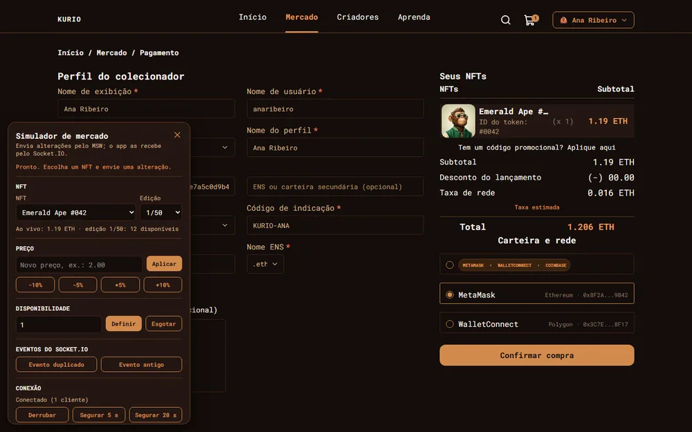

Pelo painel você consegue, sem sair da página em que está:

- **mudar o preço** de um NFT (−10%, −5%, +5%, +10% ou um valor exato) e **definir ou esgotar** a disponibilidade;
- enviar um **evento duplicado** ou um **evento antigo** pelo Socket.IO, para ver o app ignorá-los;
- **derrubar a conexão** em tempo real (`Derrubar`, `Segurar 5 s`, `Segurar 20 s`) e depois reconectar;
- trocar o **cenário de rede**: latência, tipo de falha, escopo da falha, pagamento recusado e timeout após criar o pedido;
- **restaurar** os dados e o cenário.

Tudo que o painel faz passa pelo MSW e chega ao app pelo Socket.IO, como aconteceria com um servidor de verdade. A seção 6
tem o passo a passo do preço mudando durante uma compra.

Os mesmos cenários também podem ser acionados **pela URL e pelo console do navegador**, que é o que as próximas subseções
descrevem. Isso é útil para testes automatizados e para compartilhar um link que já abre o app com uma falha ligada.

### 5.2 Selecionar o cenário pela URL ou pelo console

Pela query string (vale só para aquele carregamento):

| Parâmetro | Valores |
| --- | --- |
| `latency` | `none`, `fast` (padrão, 120 ms), `slow` (1,5 s), `variable`, `out-of-order` |
| `failure` | `none`, `offline`, `server-error`, `timeout`, `intermittent`, `unauthorized` |
| `failScope` | Prefixos de caminho separados por vírgula (`/api/cart,/api/nfts`) |
| `failEvery` | Para `intermittent`: falha 1 a cada N requisições |
| `payment` | `confirm` (padrão) ou `decline` |
| `wallet` | `accept` (padrão) ou `reject` (a conexão da carteira é recusada) |
| `orderTimeout` | `1`: a próxima criação de pedido é executada, mas a resposta nunca chega |
| `seed` | Semente da latência variável |

Exemplos: `/?latency=slow` · `/?failure=server-error&failScope=/api/nfts` · `/pagamento?payment=decline`.

Com o app já aberto, as mesmas mudanças podem ser feitas chamando as **rotas de controle** do MSW pelo console do navegador
(é o que o simulador faz por baixo). Elas ignoram a simulação de rede, então funcionam mesmo com uma falha ligada:

```js
const post = (path, body = {}) =>
  fetch(path, { method: 'POST', headers: { 'content-type': 'application/json' }, body: JSON.stringify(body) })

post('/api/__mock__/reset')                                            // restaura o cenário semeado
post('/api/__mock__/scenario', { payment: 'decline' })                 // altera o cenário
post('/api/__mock__/expire-sessions')                                  // expira todas as sessões
post('/api/__mock__/nfts/emerald-ape-042', { priceEth: '2.00' })       // muda o preço e emite nft.updated
post('/api/__mock__/nfts/emerald-ape-042', { edition: '1/50', available: 1 })
post('/api/__mock__/socket/drop', { holdMs: 5000 })                    // derruba o Socket.IO e segura a queda
post('/api/__mock__/socket/reconnect')                                 // encerra a queda
post('/api/__mock__/socket/replay', { slug: 'emerald-ape-042', mode: 'duplicate' }) // ou 'stale'
```

### 5.3 Reset

- **Reset completo:** `POST /api/__mock__/reset` (ou o botão "Restaurar dados e cenário" do simulador) restaura o cenário
  semeado de forma íntegra: catálogo de 239 NFTs, usuários, carrinhos, pedidos e cenário. O contador de versões nunca
  volta atrás, então o cliente não descarta eventos novos depois de um reset.
- **Reset manual:** apagar o `localStorage` do site e recarregar.
- Os dados são determinísticos: a latência variável vem de um gerador semeado e os ids de cotação, pedido e evento
  seguem um contador persistido.

### 5.4 Reproduzir cada cenário (com prints)

Para cada situação abaixo há o caminho mais curto e o print de como o app deve ficar. Onde o simulador (`Ctrl+Alt+M`) tem
o controle, ele é o jeito mais fácil; o console e a URL funcionam em todos os casos. Nos exemplos de console, `post` é o
helper definido na seção 5.2.

#### Lentidão e skeletons

Abra `/?latency=slow` (ou escolha a latência no simulador). Enquanto as respostas não chegam, a página mostra os
skeletons no lugar do conteúdo, sem pulo de layout.

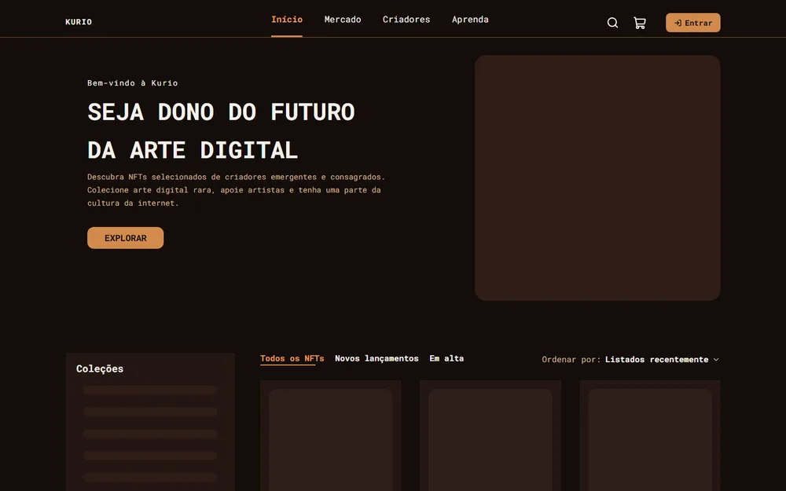

#### Respostas fora de ordem

Abra `/?latency=out-of-order` e troque rápido de aba do catálogo. As respostas chegam embaralhadas, mas o app mostra
sempre a lista da última aba escolhida. Não há print porque o resultado correto parece uma tela normal.

#### Erro HTTP e nova tentativa

Abra `/nft/emerald-ape-042?failure=server-error&failScope=/api/nfts`. Para recuperar, rode
`post('/api/__mock__/scenario', { failure: 'none', scope: [] })` e clique em **Tentar novamente**.

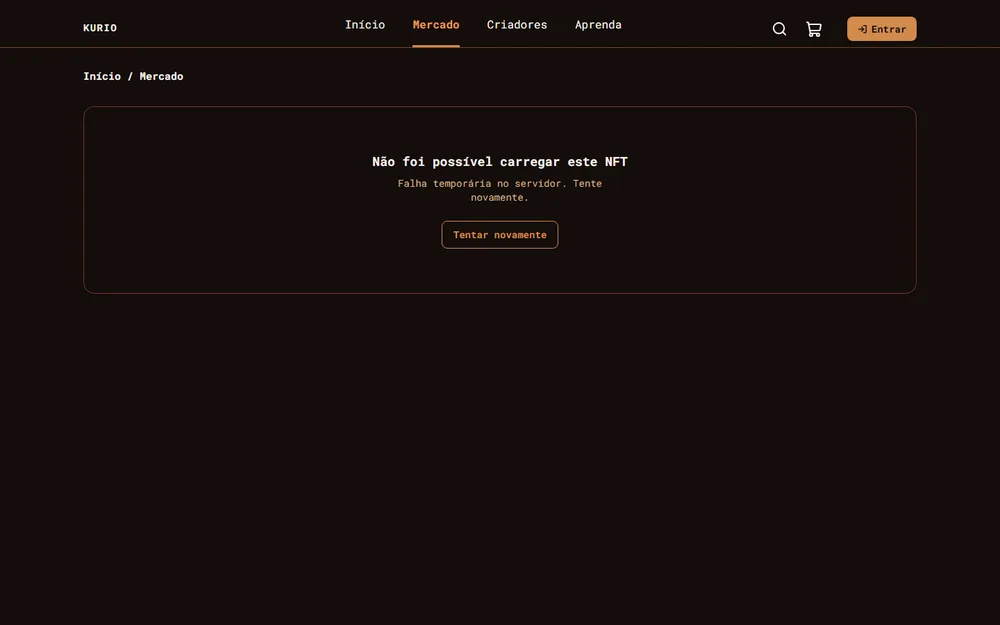

#### Sem conexão

Abra `/?failure=offline`. O catálogo explica que não foi possível conectar e oferece **Tentar novamente**.

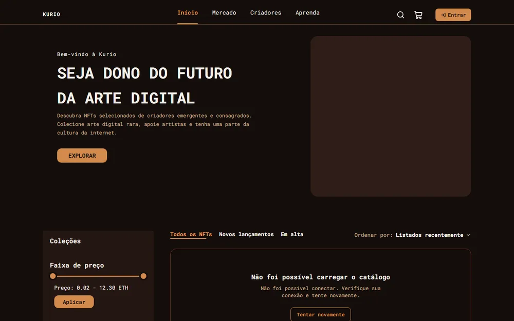

#### Sessão expirada

Entre, rode `post('/api/__mock__/expire-sessions')` e navegue, recarregue ou confirme um pedido. O app avisa, abre o login
e, depois de entrar, volta para onde você estava.

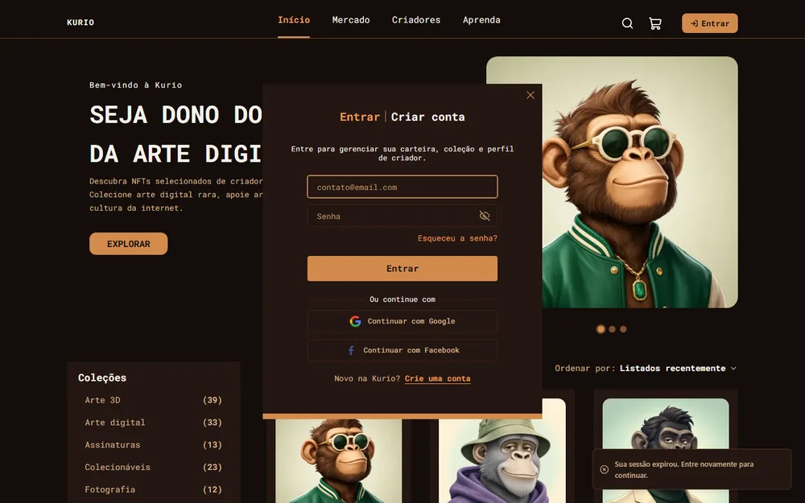

#### Conflito de cadastro

Em `/criar-conta`, cadastre o e-mail `ana@kurio.test`, que já existe.

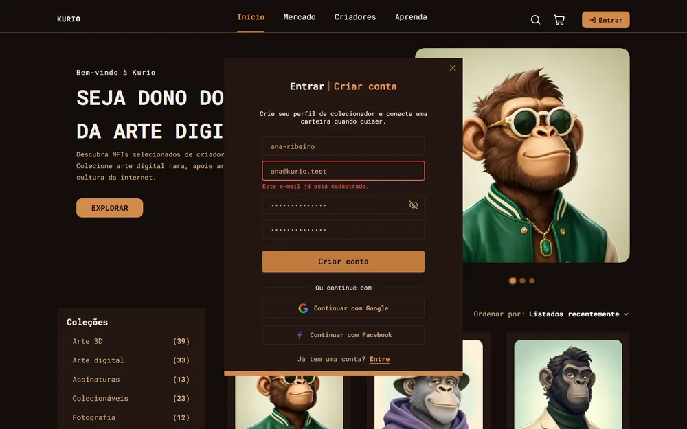

#### Resultado vazio

Busque `zzz` no catálogo. A tela explica o que houve e **Limpar filtros** restaura a lista.

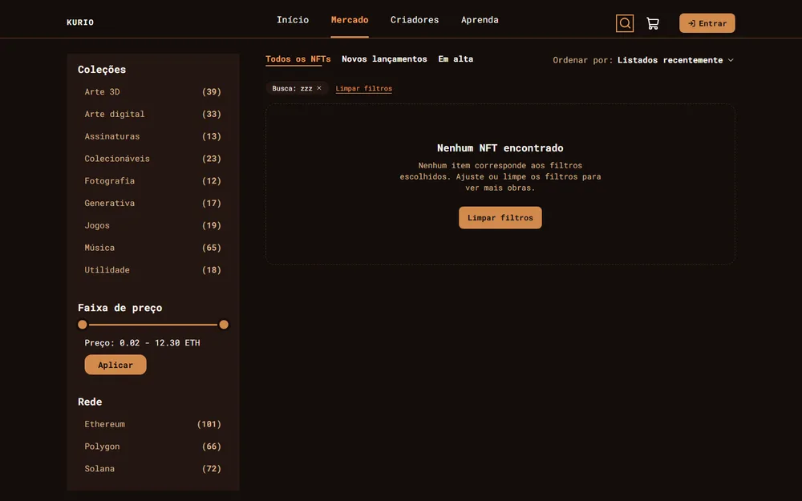

#### Cupom inválido ou expirado

No carrinho, aplique `NAOEXISTE` e depois `EXPIRADO`.

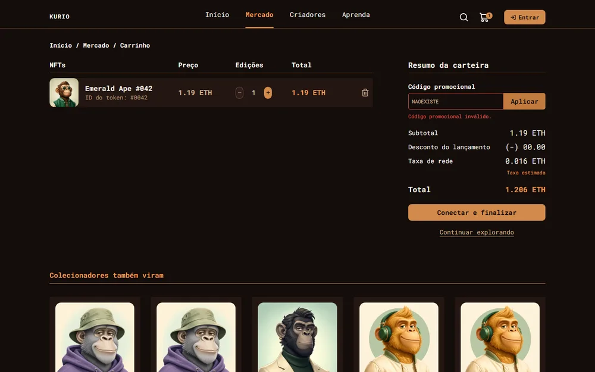


#### Pagamento recusado

Marque **Pagamento recusado** no simulador (ou rode `post('/api/__mock__/scenario', { payment: 'decline' })`) e conclua a
compra. O carrinho é preservado e dá para tentar de novo.

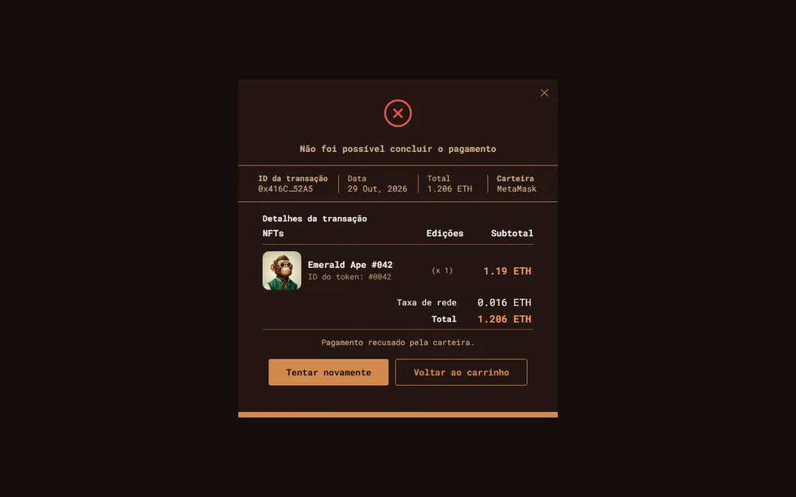

#### Carteira recusa a conexão

Rode `post('/api/__mock__/scenario', { wallet: 'reject' })` e clique em **Confirmar compra**. Depois de voltar para
`{ wallet: 'accept' }`, **Conectar novamente** funciona.

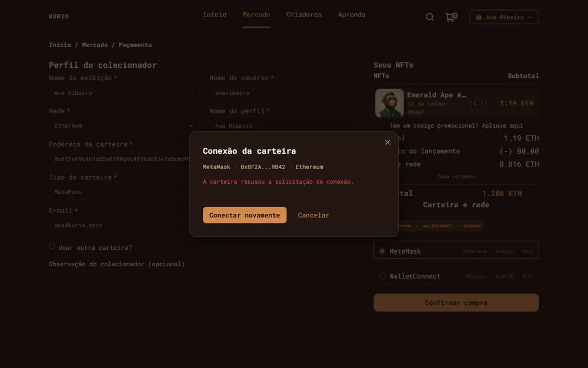

#### Timeout depois de criar o pedido

Marque **Timeout após criar o pedido** no simulador (ou `post('/api/__mock__/scenario', { orderTimeout: true })`). Passados
uns 8 segundos, use **Tentar novamente** ou **Verificar pedido**: volta o mesmo pedido, sem uma segunda compra.

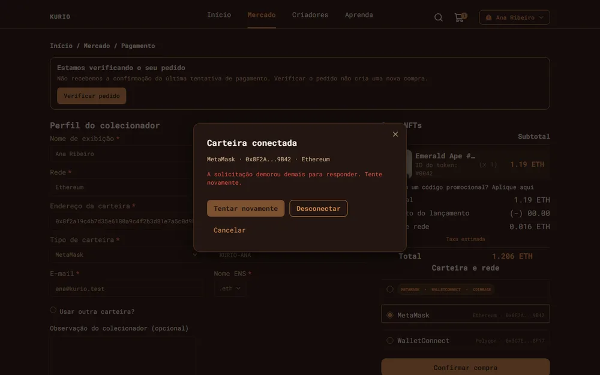

#### Preço mudou durante o checkout

No simulador, clique em **+10%** com o checkout aberto (ou `post('/api/__mock__/nfts/<slug>', { priceEth: '3.00' })`). O
alerta aparece, o resumo se atualiza e **Confirmar compra** fica bloqueado até você aceitar as alterações.

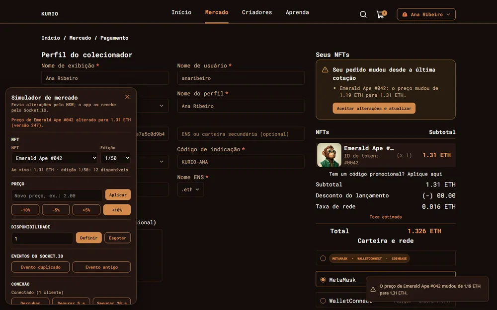

#### Edição esgotada durante a compra

No simulador, clique em **Esgotar** (ou `post('/api/__mock__/nfts/<slug>', { edition: '1/50', available: 0 })`).

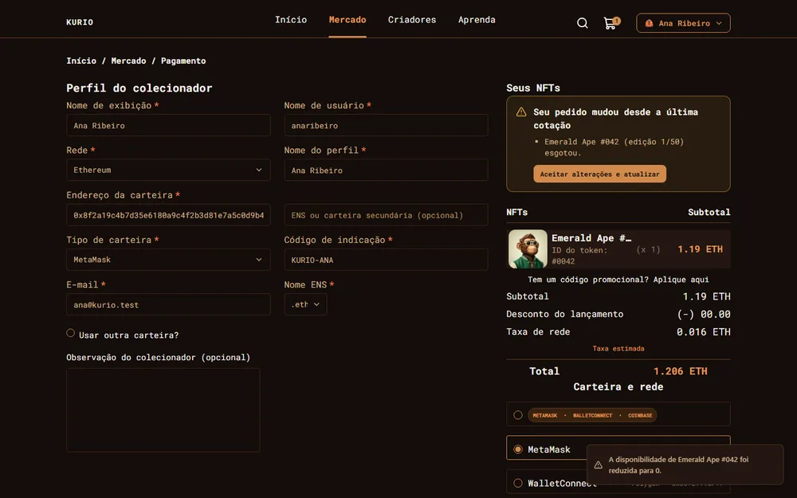

#### Queda do tempo real

No simulador, clique em **Segurar 20 s** (ou `post('/api/__mock__/socket/drop', { holdMs: 20000 })`). O cliente tenta
reconectar e, ao voltar, reconcilia o estado pela API.

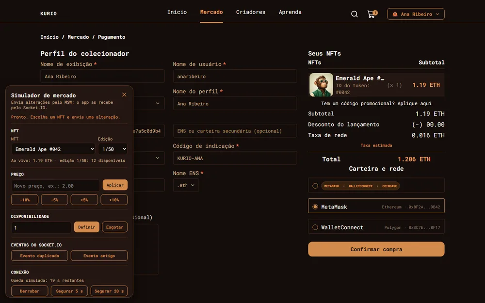

## 6. Testar o tempo real (preço mudando durante a compra)

Este é o ponto central do desafio, então vale entender o caminho do dado. Quando você muda um preço no simulador, a
alteração entra na base simulada, o servidor Socket.IO simulado emite um evento `nft.updated` e o `socket.io-client` do app
o recebe e atualiza catálogo, detalhe, carrinho e checkout. O painel **nunca** escreve direto no cache do app: o evento
percorre o mesmo caminho que percorreria com um servidor de verdade.

O painel fica oculto por padrão (assim não altera nenhum pixel do Figma). Abra-o com `Ctrl+Alt+M` (de novo, `Esc` ou o X
para fechar) ou acrescentando `?simulador=1` à URL, como em `/pagamento?simulador=1`.

Passo a passo para ver o preço mudar no meio de uma compra:

1. Abra o app, entre como Ana, adicione um NFT ao carrinho e vá para `/pagamento`.
2. Abra o simulador (`Ctrl+Alt+M`). O NFT do carrinho já vem selecionado.
3. Clique em **+10%** (ou informe um preço e **Aplicar**).
4. A interface informa a mudança: aviso na tela, nota no item do carrinho, alerta "o preço mudou" no checkout, resumo
   atualizado e **Confirmar compra bloqueado** até o usuário clicar em **Aceitar alterações e atualizar**. Se o diálogo de
   confirmação estava aberto, ele fecha e o alerta aparece.
5. Também é possível testar **Esgotar**, **Evento duplicado**, **Evento antigo** (o app os ignora), **Segurar 20 s** (derruba
   a conexão, altere preços e depois **Reconectar agora** para ver a reconciliação pela API) e os cenários de rede.

Limitação: como cada aba tem a sua própria base simulada, o simulador age sobre a aba em que foi aberto.

## 7. Testes com Playwright

```bash
npm run test:e2e              # tudo: compila, sobe o preview e roda desktop e mobile
npx playwright test e2e/cart.spec.ts                  # um arquivo
npx playwright test -g "cupom"                        # por título
npx playwright test --project=mobile                  # só o projeto mobile
npm run test:e2e:ui           # modo interativo
npm run test:e2e:report       # relatório HTML (playwright-report/)
npx playwright show-trace test-results/<pasta-da-falha>/trace.zip   # trace de uma falha
```

- **Projetos:** `desktop` (Chromium, 1440×900) roda tudo (137 testes); `mobile` (Chromium, 390×844) roda os testes marcados
  com `@mobile` (97 testes). São 31 arquivos e 234 execuções; 10 delas são puladas de propósito, por serem exclusivas de um
  layout. O resultado esperado é **224 passaram, 10 puladas**.
- **Estado isolado:** cada teste usa um contexto novo (armazenamento vazio, base semeada). Relógio, latência, falhas e eventos
  de tempo real são controlados por `page.clock`, pelos cenários e pelas rotas de controle do MSW; os eventos passam pelo
  `socket.io-client`, nunca por setters ou pelo cache.
- **Relatórios:** HTML em `playwright-report/`; traces e screenshots das falhas em `test-results/` (`trace: retain-on-failure`).
  Nenhum dos dois é versionado, porque são gerados a cada execução.
- **Servidor:** `playwright.config.ts` sempre compila e sobe um preview novo, para nunca testar um build antigo.

### 7.1 Cobertura dos 12 cenários do enunciado

| # | Cenário | Arquivos |
| --- | --- | --- |
| 1 | Busca, filtros, ordenação, paginação e histórico | `catalog`, `catalog-filters`, `catalog-states`, `mock-resilience` |
| 2 | Detalhe direto e recurso inexistente | `detail` |
| 3 | Cadastro, login, expiração, logout e troca de usuário | `auth`, `session-flows` |
| 4 | Favoritos, falha de mutation e recuperação | `favorites` |
| 5 | Carrinho, quantidades, remoção, cupom, refresh e login | `cart` |
| 6 | Compra completa até o recibo | `purchase` |
| 7 | Falha de pagamento, clique repetido, timeout e idempotência | `payment-failures`, `wallet-connection` |
| 8 | Perfil, avatar, senha e carteiras com validação | `account` |
| 9 | Preço e disponibilidade via Socket.IO durante o checkout | `realtime-price`, `market-simulator` |
| 10 | Eventos duplicados ou antigos, desconexão e pedido pendente | `realtime-resilience`, `realtime-orders`, `realtime-controls` |
| 11 | Teclado, foco de diálogos e validação | `keyboard-a11y`, `checkout-a11y`, `page-titles` |
| 12 | Skeletons, falha e nova tentativa | `loading-states`, `load-recovery`, `skeleton-layout` |

Complementares: `design-review` (os 13 comentários de revisão do Figma, um teste por correção), `visual` (regressão visual de início, detalhe, carrinho e pagamento em 1440 e 390), `responsive` (sem overflow
horizontal em 320, 390, 768 e 1440), `hero`, `tab-bar`, `modal-fit`, `fixtures-revision`.

### 7.2 Regressão visual e baselines

As baselines ficam em `e2e/__screenshots__/{projeto}/{sistema}/` e são versionadas (tolerância de 2% dos pixels, animações
desativadas, dados e relógio fixos). A renderização de texto difere entre sistemas operacionais (as alturas das páginas
variam alguns pixels), então há um conjunto para **Windows (`win32`)** e outro para **Linux (`linux`)**, este gerado com a
imagem oficial `mcr.microsoft.com/playwright` da mesma versão do `@playwright/test`. Em outro sistema (macOS, por exemplo)
os testes visuais são **pulados com uma mensagem** em vez de falhar; gere o seu conjunto com `npm run test:e2e:update`,
revise as imagens e, se quiser, versione-o. Para reproduzir as baselines Linux em qualquer máquina com Docker:

```bash
docker run --rm -v "$PWD":/src:ro mcr.microsoft.com/playwright:v1.64.1-noble bash -c 'cp -r /src /work && cd /work && npm ci && npx playwright test e2e/visual.spec.ts'
```

## 8. Auditoria Lighthouse

```bash
npm run lighthouse     # compila, sobe um servidor HTTP/2 + Brotli local e audita as duas páginas
```

Audita **início** e **detalhe do NFT**, nos perfis **mobile** (390×844, throttling simulado 4G lenta e CPU 4×) e
**desktop**, com **3 medições** por página e perfil e armazenamento limpo a cada uma, usando o build otimizado e o cenário
padrão dos mocks (latência `fast`, sem falhas). A configuração está em `lighthouse/` (`config.mjs`, `run.mjs`, `serve.mjs`);
os relatórios HTML e JSON de cada medição, o resumo `summary.json` e um índice navegável (`index.html`) ficam em
`lighthouse/reports/`. A tabela abaixo é reescrita automaticamente ao fim de cada execução.

<!-- lighthouse:start -->
Gerado em 2026-10-29T13:54:04.136Z. Mediana de 3 medições por página e perfil.

| Página | Perfil | Performance | Accessibility | Best Practices | SEO | LCP | CLS | TBT |
| --- | --- | ---: | ---: | ---: | ---: | ---: | ---: | ---: |
| Início | mobile | 92 | 100 | 100 | 100 | 2.66 s | 0.000 | 221 ms |
| Início | desktop | 100 | 97 | 100 | 100 | 0.59 s | 0.000 | 0 ms |
| Detalhe do NFT | mobile | 94 | 100 | 100 | 100 | 2.56 s | 0.000 | 193 ms |
| Detalhe do NFT | desktop | 100 | 100 | 100 | 100 | 0.56 s | 0.000 | 0 ms |

Metas do enunciado: performance ≥ 90, accessibility ≥ 95, best-practices ≥ 95, seo ≥ 90. Valores abaixo da meta aparecem em negrito. As medições individuais, os relatórios HTML/JSON de cada execução e o resumo estão em [`lighthouse/reports/index.html`](lighthouse/reports/index.html).

**Ambiente e condições de execução**

- Lighthouse: 13.6.0
- Servidor: HTTP/2 + Brotli (lighthouse/serve.mjs)
- Navegador: Chromium do Playwright, headless
- Índice de benchmark da CPU do host (Lighthouse): 1952 a 2386. Quanto menor, mais lenta a máquina e maior o TBT medido.
- Node: v24.21.0
- Plataforma: win32 x64
- Perfil mobile: emulação 390×844, DPR 2, throttling simulado do Lighthouse (4G lenta, CPU 4×)
- Perfil desktop: emulação 1350×940, throttling simulado do Lighthouse (rede cabeada, CPU 1×)
- Cenário dos mocks: padrão (latência `fast`, sem falhas), armazenamento limpo a cada execução
<!-- lighthouse:end -->

**Uma observação honesta sobre a nota mobile.** O Lighthouse simula o celular reduzindo a CPU em 4× sobre a CPU real da
máquina, então o resultado depende de quem mede: num notebook que reduz a frequência sob carga, a mesma versão pode dar
de 79 a 96. Por isso a tabela registra o índice de benchmark de cada medição. O que foi otimizado, o que ainda pesa e o
que ficou de fora estão em [ARCHITECTURE.md](ARCHITECTURE.md#9-performance). A auditoria carrega as mesmas imagens, fontes
e funcionalidades da entrega: nada foi simplificado só para melhorar a pontuação.

## 9. Deploy

O projeto está publicado em **https://case-jungle-gaming.vercel.app**. É uma aplicação estática, pronta para a Vercel
(framework Vite): `vercel.json` já define o comando de build (`npm run build`), a saída (`dist/`), a reescrita de todas as
rotas para `index.html` (acesso direto e refresh funcionam) e os cabeçalhos de cache.
O service worker do MSW (`/mockServiceWorker.js`) é servido sem cache e foi ajustado para interceptar só `/api/`
(fontes, imagens e scripts passam direto); por isso o `package.json` não declara `msw.workerDirectory`, o que evita que o
`postinstall` do MSW sobrescreva o arquivo a cada instalação. Mantenha `VITE_ENABLE_MOCKS=true` (padrão) na
demonstração.

Depois de cada deploy, vale conferir três coisas: o acesso direto (com refresh) a `/nft/emerald-ape-042`, `/carrinho` e
`/pagamento`; uma compra completa; e o simulador (`?simulador=1`) alterando o preço com um item no carrinho. Para medir a
versão publicada com o Lighthouse: `LH_URL=https://case-jungle-gaming.vercel.app npm run lighthouse`.

## 10. Estrutura do projeto

```
src/
  app/          boot em etapas, montagem do app, providers e roteador
  components/   ui (shadcn adaptado), layout, shared, nft, feedback
  contracts/    schemas Zod (REST, eventos e cenário dos mocks)
  features/     auth, catalog, nft-detail, cart, checkout, orders, favorites, profile, wallets, realtime, market-simulator
  lib/          http, query, money, url, format, realtime, auth
  mocks/        db, handlers, scenarios, fixtures, socket (carregado só no modo de mocks)
  routes/       rotas file-based do TanStack Router
e2e/            Playwright: specs, suporte e baselines visuais
lighthouse/     configuração, servidor de auditoria, scripts de medição e relatórios
build/          plugin de build (preload por rota)
scripts/        geração e verificação das artes de NFT
```
